# Lunad data model: ERD and audit

> **Source of truth for the data model as built** (approved by the owner 2026-11-24; written by AI from the live catalog). The diagrams and appendices describe migrations 0000 to 0032; the counts and checks in §1.3 were taken at 0030 (§1.5 lists what changed since): update it with every later migration. `db/migrations/` decides if they ever disagree. The audit in §3 is a snapshot of that date.
>
> Date: 2026-11-24. Commit: `c5293bbdf7a515c5ad8ce2c221537d55f94eb277` (`main`) when the catalog was read; `main` moved to `9959a76` while this was written, with no change under `db/` or `src/server/`. Database: PostgreSQL 18.7, throwaway Neon branch of `main`, migrations 0000 to 0030.

Contents: [1 Overview](#1-overview) · [2 Diagrams](#2-diagrams) · [3 Audit](#3-postgresql-and-neon-audit) · [4 Alignment](#4-alignment-check) · [5 Proposed migrations](#5-proposed-migrations-words-only) · [6 Before new code](#6-before-new-code) · Appendices A to D

## 1. Overview

### 1.1 Schemas

| Schema | Tables | Purpose | RLS |
|---|---|---|---|
| `core` | 10 | Profiles, roles, saved items, media objects, acknowledgements, audit, step-up | enabled and forced |
| `ingest` | 8 | Source documents, import batches, raw features, conflicts | enabled and forced |
| `transit` | 46 (plus 31 views) | Revisioned transport data; public reads go through `v_published_*` | enabled and forced |
| `community` | 13 | Posts, comments, corrections, moderation, appeals | enabled and forced |
| `priv` | 5 | Driver complaints and evidence (restricted) | enabled and forced |
| `ops` | 7 | Jobs, rate limits, Places cache, provider health, flags | enabled and forced |
| **App total** | **89** | | **89 of 89** |
| `public` | 1 | `schema_migrations` (no grant to runtime roles) | off |
| `neon_auth` | 9 | Managed by Neon Auth; owner `neon_auth` | managed by Neon |

Also in the app schemas: 851 columns, 79 foreign keys, 106 functions (81 SECURITY DEFINER), 4 triggers, 316 policies, 2 sequences, and no enum or domain types (every value set is a `CHECK`). Extensions: postgis 3.6.4, pg_trgm 1.6, unaccent 1.1 and btree_gist 1.8 in schema `extensions`.

Roles: `paranaga_app` (runtime, pooled URL), `paranaga_import` (CLI imports), `paranaga_definer` (owns definer functions). None is superuser, has BYPASSRLS, or can create roles or databases. `neondb_owner` has BYPASSRLS and runs migrations only.

### 1.2 Conventions that shape the diagrams

- **Versioned entities.** A stable identity row (`stop_point`) plus immutable `*_version` rows. `transit.revision_member` records which version a revision uses, as (`entity_kind`, `entity_id`, `version_id`). **A foreign key is impossible there by design**: one column points at 27 tables. The check is `transit.publish_revision`, which refuses a member that does not resolve. Membership is frozen once the revision is no longer a draft (trigger `revision_member_guard`).
- **Published pointer.** `transit.published_pointer` holds at most one row (`singleton` primary key). Cardinality in the diagrams comes from constraints, so it shows as "many".
- **Polymorphic targets.** `target_type` + `target_id` in `community` (`reaction`, `content_report`, `jev_evidence`, `moderation_decision`, `appeal`), and `entity_type` + `entity_id` in `core.audit_event` and `community.correction`. No foreign key is possible.
- **Arrays of codes.** PostgreSQL has no foreign keys on array elements, so `source_codes text[]` cannot reference `ingest.source`.
- **User ids are `text`**, while `neon_auth."user".id` is `uuid` in a schema this repo does not own. Nothing references it by key.
- **`ingest.source` is append-only** (import role: SELECT and INSERT only).
- **Reading the diagrams.** Solid lines are foreign keys; dashed lines are logical references with no key. Left end: `||` = the key columns are NOT NULL, `|o` = nullable. Right end: `o|` = a unique constraint allows one child, `o{` = many. `UK` marks a single-column unique; composite uniques are in the column comment. `null` = nullable. An entity without columns lives in another diagram. Types: `_array` = array, `geography_Point_4326` = `geography(Point,4326)`.

### 1.3 Verified against

| Check | Result |
|---|---|
| Migration checksums | `pnpm db:migrate` on the branch reported "migrations up to date": all 31 files (0000 to 0030) match the stored hashes, none pending |
| Tables and views | 89 and 31 in the migrations, the same in the catalog |
| Columns | All 851 catalog columns have a definition in the migrations; no migration column is missing from the catalog |
| Foreign keys | 79 `references` clauses, 79 in the catalog |
| Secondary indexes | 94 in the migrations, the same 94 in the catalog, all valid |
| Named constraints | 89 in the migrations; the two missing from the catalog were dropped by later migrations |
| Policies | All 139 literal policies are present. The other 177 come from `format()` loops and carry the expected names |
| Function bodies | 94 of 106 byte-identical to the last migration text; 12 differ only in whitespace, comments or carriage returns |

**Drift: none that changes behaviour.** The 12 text differences are cosmetic: `core.audit`, `core.bootstrap_admin`, `core.ensure_commuter` and `core.has_role` contain carriage returns from a CRLF checkout; `core.create_media_slot`, `core.find_orphan_media_slots`, five `ops` functions (0014) and `priv.set_mynaga_handoff` are stored with collapsed whitespace.

**Not verified:** production settings and load. Only the catalog of a fresh branch was read (no table rows, no DDL). `pg_stat_*` on a new branch is not representative, so nothing here infers real usage. Row counts are planner estimates (`reltuples`). Concurrency findings come from reading the SQL; none was reproduced. Timeouts and connection limits come from the branch compute; production may differ.

**Diagram counts, computed from the generated text and compared with the catalog (equal on every line):**

| Diagram | Tables | Columns | FKs (solid) | Logical (dashed) |
|---|---|---|---|---|
| core | 10 | 83 | 2 | 9 |
| ingest | 8 | 64 | 7 | 2 |
| transit-revisions | 3 | 21 | 3 | 37 |
| transit-routes | 12 | 143 | 14 | 10 |
| transit-stops | 6 | 61 | 16 | 0 |
| transit-regional | 8 | 99 | 4 | 10 |
| transit-fares | 4 | 48 | 5 | 3 |
| transit-geo | 6 | 55 | 6 | 1 |
| transit-reference | 7 | 46 | 1 | 6 |
| community (139 at 0030, 142 now) | 13 | 139 | 15 | 19 |
| priv | 5 | 57 | 6 | 1 |
| ops | 7 | 35 | 0 | 0 |
| public | 1 | 3 | 0 | 0 |
| neon_auth | 9 | 79 | 6 | 0 |
| **App schemas, diagrams** | **89** | **851** | **79** | **98** |
| **App schemas, catalog** | **89** | **851** | **79** | not applicable |
| All schemas, diagrams | 99 | 933 | 85 | 98 |
| All schemas, catalog | 99 | 933 | 85 | not applicable |

**Syntax:** all 15 diagrams were parsed without error by `mermaid` 11.12.0, installed outside the repo. A deliberately broken sample was rejected, so the check works. Rendering was not checked visually.

### 1.4 How to regenerate

The helper scripts lived in a temporary directory and are not committed. To repeat:

1. `bash scripts/with-neon-branch.sh node <dump script>`. The script opens `DATABASE_URL`, runs `begin read only`, and reads `pg_class`, `pg_attribute`, `pg_attrdef`, `pg_constraint`, `pg_index`, `pg_policies`, `pg_proc`, `pg_trigger`, `pg_type`, `pg_roles` and the ACL columns for the schemas in §1.1. It writes JSON and reads no table rows. The wrapper always deletes the branch.
2. Generate one entity block per table and one solid line per `pg_constraint` row with `contype = 'f'`; add the logical references listed in §4.5.
3. Compare block, column and solid-line counts with the catalog, and run `mermaid.parse` on each diagram.

If this document becomes the source of truth, move the dump and generator into `scripts/` (owner decision).

### 1.5 Changes since the catalog was read

| Migration | Changed | Closes |
|---|---|---|
| 0031 | Functions only: `transit.admin_publish_revision` (a draft must come from the live revision), `admin_create_draft`, `admin_open_draft` | C1 |
| 0032 | `taken_down_at` on `post_version`, `comment`, `post_photo` (each with a CHECK); `appeal_target_uq` replaced by `appeal_target_idx` (one appeal per decision); `reaction_target_idx`, `content_report_open_target_idx`; `created_at` default `clock_timestamp()` on `moderation_decision` and `appeal`; new `community.admin_take_down`, `admin_report_queue`; `resolve_report` takes four arguments; changed `content_target`, `apply_content_outcome`, `submit_appeal`, `report_content`, `toggle_reaction`, `toggle_bookmark` | C2, C3, C4, I1, I2 |
| 0033 | `evidence_access_complaint_idx`, `moderation_decision_created_idx` | I3, I4 |
| 0034 | App role updates only `profile` (`display_name`, `locale`) and `job` (`run_after`); execute revoked on `community.review_queue`, `community.content_review_queue`, `priv.review_queue` | S1, S2, S3 |
| 0035 | `paranaga_app`: `statement_timeout` 15 s, `lock_timeout` 5 s; both answer 503. The import role and the owner have none | O3 |
| code, no migration | Daily Vercel cron, queued rate-limit purge, 40P01/40001/23505 handling, saved trips with an unknown revision, storage timeouts, `schema.ts` cut to the tables in use | O1, O2, C5, F1, C6, §4.1 |

App schemas now: 89 tables, 854 columns, 79 foreign keys, 83 SECURITY DEFINER functions.

## 2. Diagrams

### 2.0 Overview: cross-schema relations (names only)

Solid: the 15 foreign keys that cross schemas. Dashed: 9 cross-schema logical references with no foreign key (the `source_codes` references to `ingest.source` are drawn only in the detailed diagrams). These lines repeat in the detailed diagrams, so the counts in §1.3 use the detailed diagrams only.

```mermaid
erDiagram
  community_comment["community.comment"]
  community_correction["community.correction"]
  community_post["community.post"]
  community_post_photo["community.post_photo"]
  core_media_object["core.media_object"]
  core_profile["core.profile"]
  core_saved_trip["core.saved_trip"]
  ingest_raw_feature["ingest.raw_feature"]
  ingest_raw_feature_lineage["ingest.raw_feature_lineage"]
  ingest_source["ingest.source"]
  neon_auth_user["neon_auth.user"]
  priv_complaint["priv.complaint"]
  priv_complaint_media["priv.complaint_media"]
  priv_evidence_access["priv.evidence_access"]
  transit_evidence["transit.evidence"]
  transit_place_version["transit.place_version"]
  transit_revision["transit.revision"]
  transit_route["transit.route"]
  transit_shape_version["transit.shape_version"]
  transit_stop_point["transit.stop_point"]
  transit_stop_point_source["transit.stop_point_source"]
  transit_walk_graph_version["transit.walk_graph_version"]
  transit_revision |o--o{ community_correction : "draft_revision_id"
  transit_revision |o--o{ community_correction : "entity_revision_id"
  transit_revision |o--o{ community_correction : "incorporated_revision_id"
  core_media_object ||--o| community_post_photo : "media_object_id"
  transit_revision ||--o{ core_saved_trip : "revision_id"
  transit_stop_point ||--o{ ingest_raw_feature_lineage : "stop_point_id"
  core_media_object ||--o| priv_complaint_media : "media_object_id"
  core_media_object ||--o{ priv_evidence_access : "media_object_id"
  core_media_object |o--o{ transit_evidence : "media_object_id"
  ingest_source |o--o{ transit_evidence : "source_code"
  ingest_raw_feature ||--o{ transit_place_version : "raw_feature_id"
  ingest_source ||--o{ transit_place_version : "source_code"
  ingest_source ||--o{ transit_shape_version : "road_source_code"
  ingest_raw_feature ||--o{ transit_stop_point_source : "raw_feature_id"
  ingest_source ||--o{ transit_walk_graph_version : "road_source_code"
  core_media_object }o..o{ community_correction : "media_ids uuid array"
  transit_stop_point |o..o{ community_correction : "entity_id text when entity_type=stop"
  transit_route |o..o{ community_correction : "entity_id text = public_code when entity_type=route"
  transit_route |o..o{ community_post : "route_code = public_code"
  neon_auth_user ||..o| core_profile : "user_id = id::text"
  core_profile ||..o{ community_post : "author_id"
  core_profile ||..o{ community_comment : "author_id"
  core_profile ||..o{ community_correction : "author_id"
  core_profile ||..o{ priv_complaint : "reporter_id"
```

### 2.1 core: accounts, roles, saved items, media, audit

10 tables, 83 columns, 2 foreign keys, 9 logical references.

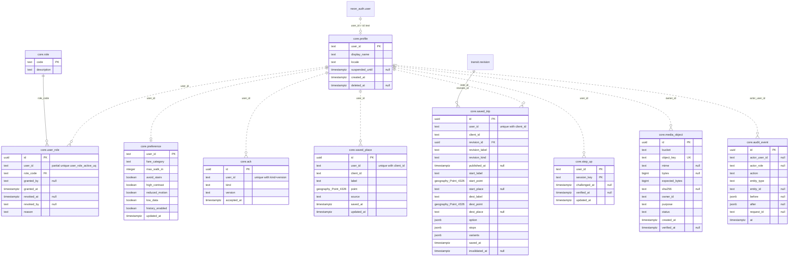

### 2.2 ingest: provenance and imports

8 tables, 64 columns, 7 foreign keys, 2 logical references.

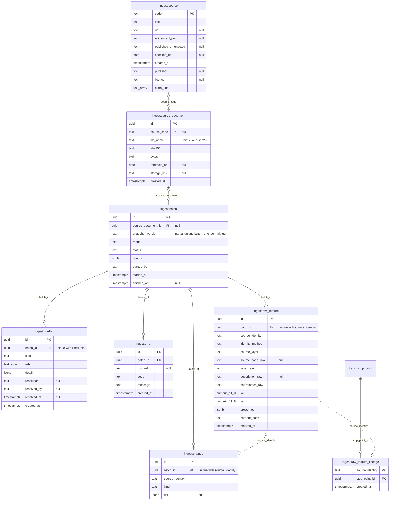

### 2.3 transit 1: revisions and publication

3 tables, 21 columns, 3 foreign keys, 37 logical references.

```mermaid
erDiagram
  transit_revision["transit.revision"] {
    uuid id PK
    bigint seq UK "identity"
    text label UK
    text kind
    text status
    text created_by
    timestamptz created_at
    text published_by "null"
    timestamptz published_at "null"
    uuid parent_revision_id FK "null"
    jsonb validation_report "null"
    text content_hash "null"
    boolean is_synthetic
    text last_edited_by "null"
  }
  transit_revision_member["transit.revision_member"] {
    uuid revision_id PK, FK
    text entity_kind PK
    uuid entity_id PK
    uuid version_id
  }
  transit_published_pointer["transit.published_pointer"] {
    boolean singleton PK
    uuid revision_id FK
    timestamptz updated_at
  }
  transit_barangay["transit.barangay"]
  transit_coverage_audit["transit.coverage_audit"]
  transit_dataset_note["transit.dataset_note"]
  transit_designated_stop_candidate["transit.designated_stop_candidate"]
  transit_eta_param["transit.eta_param"]
  transit_eta_param_version["transit.eta_param_version"]
  transit_external_destination_category["transit.external_destination_category"]
  transit_fare_conflict["transit.fare_conflict"]
  transit_fare_observation["transit.fare_observation"]
  transit_fare_rule["transit.fare_rule"]
  transit_fare_rule_version["transit.fare_rule_version"]
  transit_feeder_lead["transit.feeder_lead"]
  transit_place["transit.place"]
  transit_place_version["transit.place_version"]
  transit_provider_presence["transit.provider_presence"]
  transit_rail_status["transit.rail_status"]
  transit_regional_destination["transit.regional_destination"]
  transit_regional_destination_version["transit.regional_destination_version"]
  transit_regional_service["transit.regional_service"]
  transit_regional_service_version["transit.regional_service_version"]
  transit_route["transit.route"]
  transit_route_alias["transit.route_alias"]
  transit_route_cooperative["transit.route_cooperative"]
  transit_route_fare_observation["transit.route_fare_observation"]
  transit_route_note["transit.route_note"]
  transit_route_operating_status["transit.route_operating_status"]
  transit_route_vehicle_class["transit.route_vehicle_class"]
  transit_shape["transit.shape"]
  transit_shape_version["transit.shape_version"]
  transit_stop_point["transit.stop_point"]
  transit_stop_point_version["transit.stop_point_version"]
  transit_terminal["transit.terminal"]
  transit_terminal_version["transit.terminal_version"]
  transit_variant["transit.variant"]
  transit_variant_version["transit.variant_version"]
  transit_walk_graph["transit.walk_graph"]
  transit_walk_graph_version["transit.walk_graph_version"]
  transit_revision |o--o{ transit_revision : "parent_revision_id"
  transit_revision ||--o{ transit_revision_member : "revision_id"
  transit_revision ||--o{ transit_published_pointer : "revision_id"
  transit_route |o..o{ transit_revision_member : "entity_kind=route, entity_id"
  transit_route_alias |o..o{ transit_revision_member : "entity_kind=route_alias, entity_id"
  transit_variant |o..o{ transit_revision_member : "entity_kind=variant, entity_id"
  transit_stop_point |o..o{ transit_revision_member : "entity_kind=stop_point, entity_id"
  transit_terminal |o..o{ transit_revision_member : "entity_kind=terminal, entity_id"
  transit_fare_rule |o..o{ transit_revision_member : "entity_kind=fare_rule, entity_id"
  transit_fare_observation |o..o{ transit_revision_member : "entity_kind=fare_observation, entity_id"
  transit_fare_conflict |o..o{ transit_revision_member : "entity_kind=fare_conflict, entity_id"
  transit_barangay |o..o{ transit_revision_member : "entity_kind=barangay, entity_id"
  transit_coverage_audit |o..o{ transit_revision_member : "entity_kind=coverage_audit, entity_id"
  transit_feeder_lead |o..o{ transit_revision_member : "entity_kind=feeder_lead, entity_id"
  transit_provider_presence |o..o{ transit_revision_member : "entity_kind=provider_presence, entity_id"
  transit_rail_status |o..o{ transit_revision_member : "entity_kind=rail_status, entity_id"
  transit_designated_stop_candidate |o..o{ transit_revision_member : "entity_kind=designated_stop_candidate, entity_id"
  transit_external_destination_category |o..o{ transit_revision_member : "entity_kind=external_destination_category, entity_id"
  transit_dataset_note |o..o{ transit_revision_member : "entity_kind=dataset_note, entity_id"
  transit_place |o..o{ transit_revision_member : "entity_kind=place, entity_id"
  transit_route_vehicle_class |o..o{ transit_revision_member : "entity_kind=route_vehicle_class, entity_id"
  transit_route_cooperative |o..o{ transit_revision_member : "entity_kind=route_cooperative, entity_id"
  transit_route_operating_status |o..o{ transit_revision_member : "entity_kind=route_operating_status, entity_id"
  transit_route_fare_observation |o..o{ transit_revision_member : "entity_kind=route_fare_observation, entity_id"
  transit_regional_service |o..o{ transit_revision_member : "entity_kind=regional_service, entity_id"
  transit_shape |o..o{ transit_revision_member : "entity_kind=shape, entity_id"
  transit_walk_graph |o..o{ transit_revision_member : "entity_kind=walk_graph, entity_id"
  transit_eta_param |o..o{ transit_revision_member : "entity_kind=eta_param, entity_id"
  transit_route_note |o..o{ transit_revision_member : "entity_kind=route_note, entity_id"
  transit_regional_destination |o..o{ transit_revision_member : "entity_kind=regional_destination, entity_id"
  transit_variant_version |o..o{ transit_revision_member : "version_id when entity_kind=variant"
  transit_stop_point_version |o..o{ transit_revision_member : "version_id when entity_kind=stop_point"
  transit_place_version |o..o{ transit_revision_member : "version_id when entity_kind=place"
  transit_fare_rule_version |o..o{ transit_revision_member : "version_id when entity_kind=fare_rule"
  transit_terminal_version |o..o{ transit_revision_member : "version_id when entity_kind=terminal"
  transit_regional_service_version |o..o{ transit_revision_member : "version_id when entity_kind=regional_service"
  transit_shape_version |o..o{ transit_revision_member : "version_id when entity_kind=shape"
  transit_walk_graph_version |o..o{ transit_revision_member : "version_id when entity_kind=walk_graph"
  transit_eta_param_version |o..o{ transit_revision_member : "version_id when entity_kind=eta_param"
  transit_regional_destination_version |o..o{ transit_revision_member : "version_id when entity_kind=regional_destination"
```

### 2.4 transit 2: routes, variants, paths

12 tables, 143 columns, 14 foreign keys, 10 logical references.

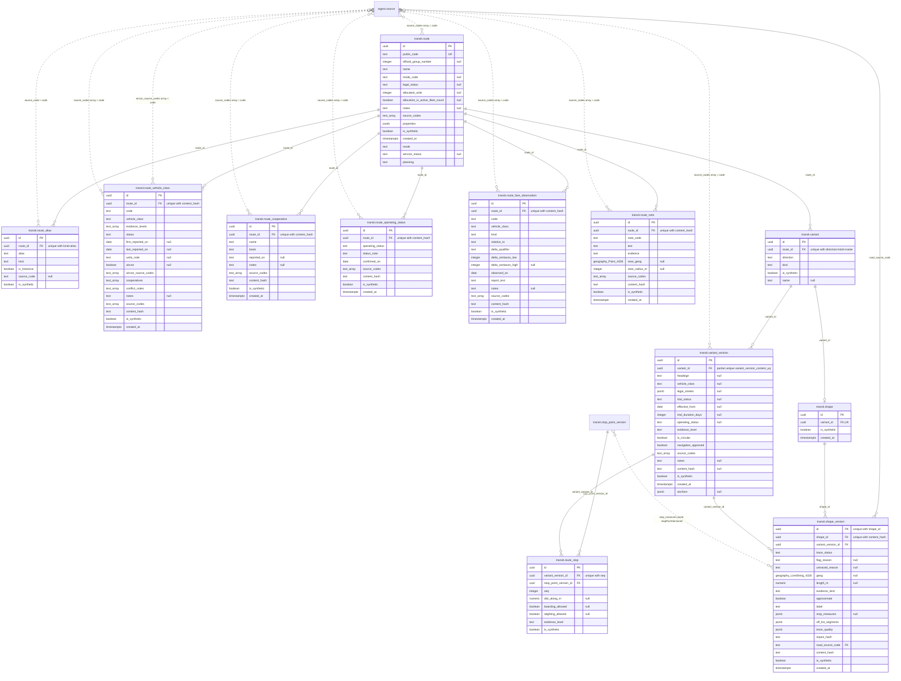

### 2.5 transit 3: stops, evidence, reconciliation

6 tables, 61 columns, 16 foreign keys, 0 logical references.

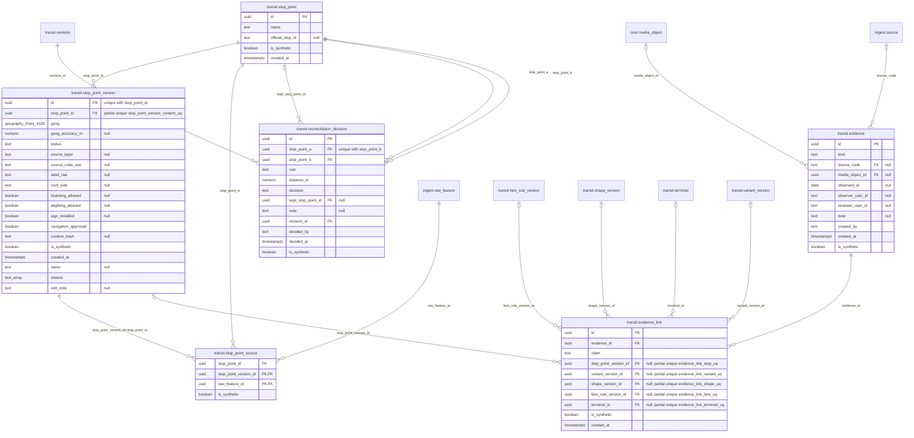

### 2.6 transit 4: terminals and regional services

8 tables, 99 columns, 4 foreign keys, 10 logical references.

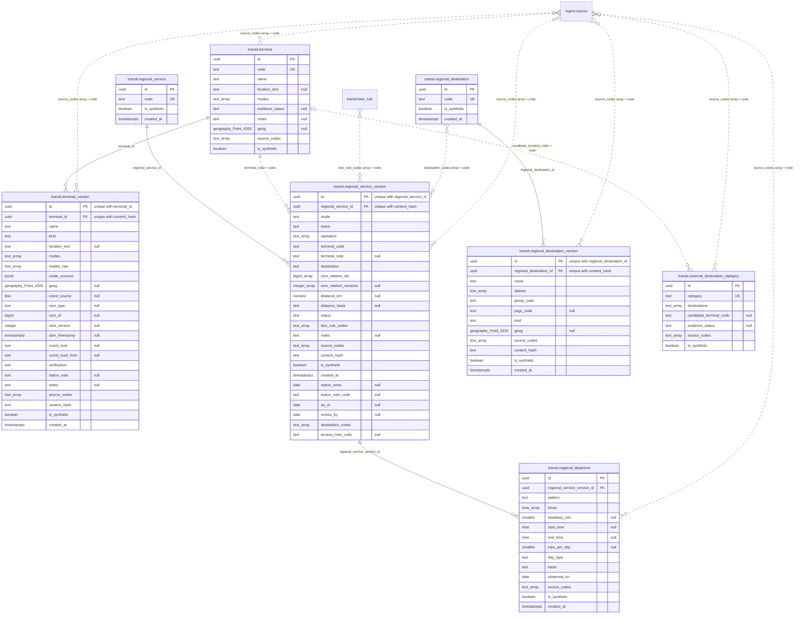

### 2.7 transit 5: fares

4 tables, 48 columns, 5 foreign keys, 3 logical references.

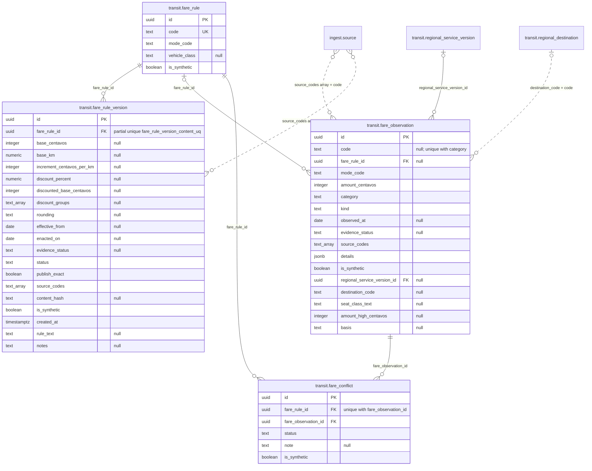

### 2.8 transit 6: places, walk graph, time estimates

6 tables, 55 columns, 6 foreign keys, 1 logical references.

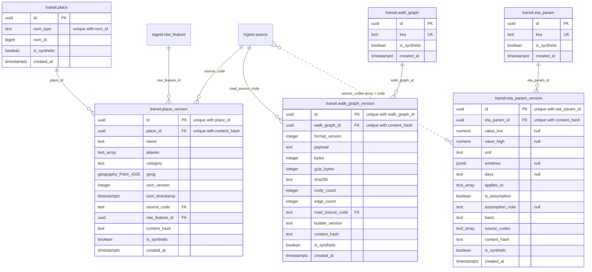

### 2.9 transit 7: reference and survey records

7 tables, 46 columns, 1 foreign keys, 6 logical references.

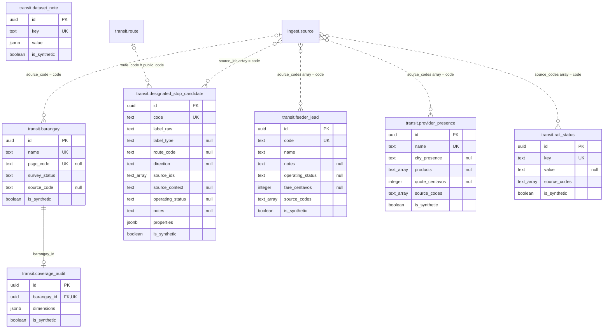

### 2.10 community: hub, corrections, moderation

13 tables, 139 columns, 15 foreign keys, 19 logical references.

```mermaid
erDiagram
  community_appeal["community.appeal"] {
    uuid id PK
    uuid decision_id FK, UK
    text target_type
    uuid target_id
    text author_id
    text note
    text original_decider
    text status
    text resolved_by "null"
    timestamptz resolved_at "null"
    uuid resolution_decision_id FK "null"
    timestamptz created_at
  }
  community_bookmark["community.bookmark"] {
    text user_id PK
    uuid post_id PK, FK
    timestamptz created_at
  }
  community_comment["community.comment"] {
    uuid id PK
    uuid post_id FK
    uuid parent_comment_id FK "null"
    smallint depth
    text author_id "unique with client_request_id"
    uuid client_request_id
    text body
    text moderation_status
    text moderation_reason "null"
    integer helpful_count
    timestamptz deleted_at "null"
    timestamptz created_at
    timestamptz decided_at "null"
    timestamptz taken_down_at "null"
  }
  community_content_report["community.content_report"] {
    uuid id PK
    text reporter_id "unique with target_type+target_id"
    text target_type
    uuid target_id
    text reason
    text note "null"
    text status
    timestamptz created_at
    text resolved_by "null"
    timestamptz resolved_at "null"
  }
  community_correction["community.correction"] {
    uuid id PK
    text author_id "unique with client_request_id"
    uuid client_request_id
    text entity_type
    text entity_id
    text entity_label "null"
    uuid entity_revision_id FK "null"
    text kind
    text description
    jsonb proposed
    timestamptz observed_at
    geography_Point_4326 location "null"
    numeric location_accuracy_m "null"
    uuid_array media_ids
    text status
    text moderation_reason "null"
    uuid duplicate_of FK "null"
    text reviewer_note "null"
    uuid incorporated_revision_id FK "null"
    timestamptz submitted_at "null"
    timestamptz created_at
    timestamptz updated_at
    uuid draft_revision_id FK "null"
    jsonb draft_change "null"
    text reviewed_by "null"
    timestamptz reviewed_at "null"
  }
  community_correction_event["community.correction_event"] {
    uuid id PK
    uuid correction_id FK
    text from_status "null"
    text to_status
    text actor_id "null"
    text actor_role "null"
    text reason_code "null"
    text note "null"
    timestamptz at
  }
  community_jev_evidence["community.jev_evidence"] {
    uuid id PK
    text target_type "unique with target_id"
    uuid target_id
    text recommendation "null"
    numeric confidence "null"
    text unavailable_reason "null"
    text policy_version "null"
    text model "null"
    timestamptz created_at
  }
  community_moderation_decision["community.moderation_decision"] {
    uuid id PK
    text target_type
    uuid target_id
    text author_id
    text outcome
    text decided_by
    text decider_role
    text reason_code
    text note "null"
    text jev_recommendation "null"
    numeric jev_confidence "null"
    boolean is_override
    uuid appeal_id FK "null"
    timestamptz created_at
  }
  community_post["community.post"] {
    uuid id PK
    bigint seq UK "identity"
    text author_id "unique with client_request_id"
    uuid client_request_id
    text topic
    text route_code "null"
    text label
    uuid published_version_id FK "null"
    integer helpful_count
    timestamptz deleted_at "null"
    timestamptz created_at
    timestamptz updated_at
  }
  community_post_photo["community.post_photo"] {
    uuid id PK
    uuid post_id FK "unique with position"
    uuid media_object_id FK, UK
    text author_id
    smallint position
    text moderation_status
    text public_bucket "null"
    text public_key "null"
    timestamptz decided_at "null"
    timestamptz created_at
    timestamptz taken_down_at "null"
  }
  community_post_version["community.post_version"] {
    uuid id PK
    uuid post_id FK "unique with n; partial unique post_version_one_live_idx; partial unique post_version_request_idx"
    integer n
    text author_id
    uuid client_request_id "null"
    text title
    text body
    text_array tags
    text moderation_status
    text moderation_reason "null"
    timestamptz submitted_at
    timestamptz decided_at "null"
    timestamptz taken_down_at "null"
  }
  community_reaction["community.reaction"] {
    text user_id PK
    text target_type PK
    uuid target_id PK
    text kind
    timestamptz created_at
  }
  community_user_block["community.user_block"] {
    uuid id PK
    text blocker_id "unique with blocked_id"
    text blocked_id
    timestamptz created_at
  }
  core_media_object["core.media_object"]
  core_profile["core.profile"]
  transit_revision["transit.revision"]
  transit_route["transit.route"]
  transit_stop_point["transit.stop_point"]
  community_moderation_decision ||--o| community_appeal : "decision_id"
  community_moderation_decision |o--o{ community_appeal : "resolution_decision_id"
  community_post ||--o{ community_bookmark : "post_id on delete cascade"
  community_comment |o--o{ community_comment : "parent_comment_id"
  community_post ||--o{ community_comment : "post_id on delete cascade"
  transit_revision |o--o{ community_correction : "draft_revision_id"
  community_correction |o--o{ community_correction : "duplicate_of"
  transit_revision |o--o{ community_correction : "entity_revision_id"
  transit_revision |o--o{ community_correction : "incorporated_revision_id"
  community_correction ||--o{ community_correction_event : "correction_id on delete cascade"
  community_appeal |o--o{ community_moderation_decision : "appeal_id"
  community_post_version |o--o{ community_post : "published_version_id"
  core_media_object ||--o| community_post_photo : "media_object_id"
  community_post ||--o{ community_post_photo : "post_id on delete cascade"
  community_post ||--o{ community_post_version : "post_id on delete cascade"
  core_media_object }o..o{ community_correction : "media_ids uuid array"
  transit_stop_point |o..o{ community_correction : "entity_id text when entity_type=stop"
  transit_route |o..o{ community_correction : "entity_id text = public_code when entity_type=route"
  transit_route |o..o{ community_post : "route_code = public_code"
  community_post |o..o{ community_reaction : "target_type=post, target_id"
  community_comment |o..o{ community_reaction : "target_type=comment, target_id"
  community_post |o..o{ community_content_report : "target_type=post, target_id"
  community_comment |o..o{ community_content_report : "target_type=comment, target_id"
  community_post_version |o..o| community_jev_evidence : "target_type=post_version, target_id"
  community_comment |o..o| community_jev_evidence : "target_type=comment, target_id"
  community_post_version |o..o{ community_moderation_decision : "target_type=post_version, target_id"
  community_comment |o..o{ community_moderation_decision : "target_type=comment, target_id"
  community_post_photo |o..o{ community_moderation_decision : "target_type=photo, target_id"
  community_post_version |o..o| community_appeal : "target_type=post_version, target_id"
  community_comment |o..o| community_appeal : "target_type=comment, target_id"
  community_post_photo |o..o| community_appeal : "target_type=photo, target_id"
  core_profile ||..o{ community_post : "author_id"
  core_profile ||..o{ community_comment : "author_id"
  core_profile ||..o{ community_correction : "author_id"
```

### 2.11 priv: driver complaints (restricted)

5 tables, 57 columns, 6 foreign keys, 1 logical references.

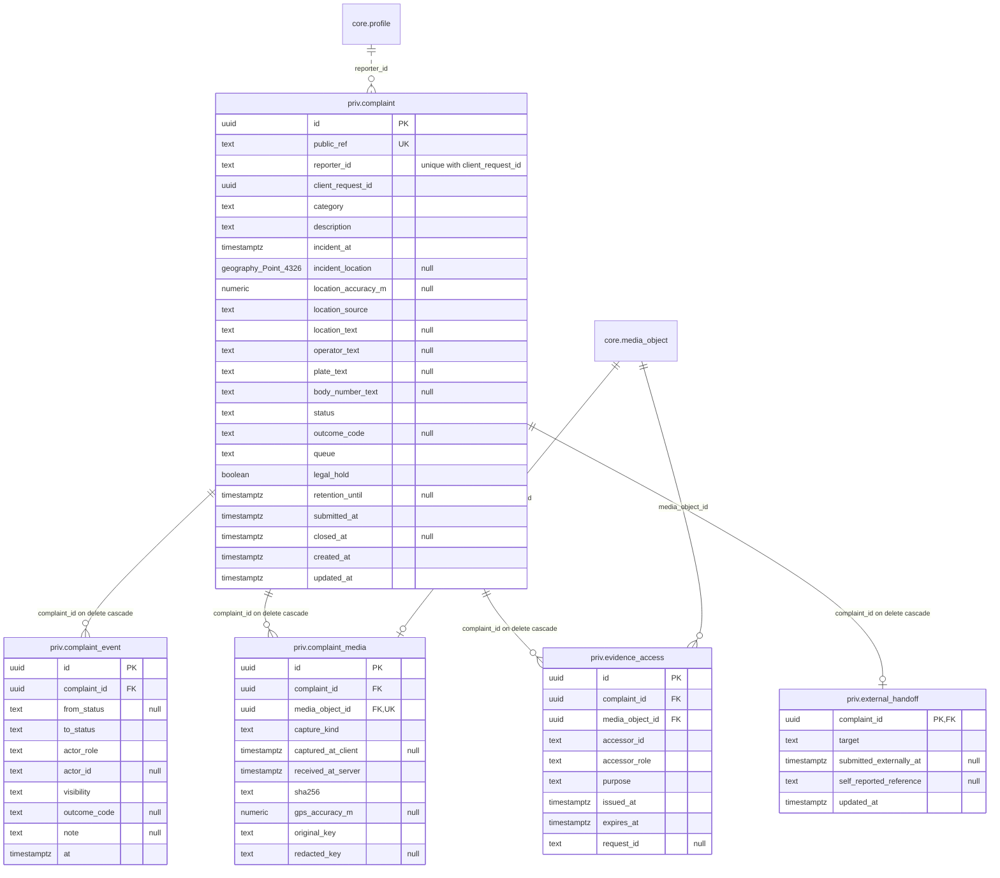

### 2.12 ops: jobs, limits, providers

7 tables, 35 columns, 0 foreign keys, 0 logical references.

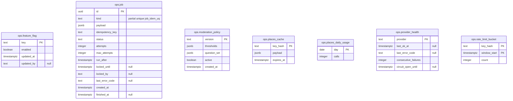

### 2.13 public: migration ledger

1 tables, 3 columns, 0 foreign keys, 0 logical references.

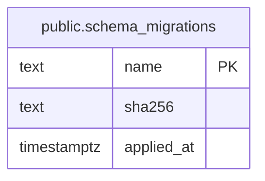

### 2.14 neon_auth: managed by Neon Auth (external, not migrated by this repo)

9 tables, 79 columns, 6 foreign keys, 0 logical references.

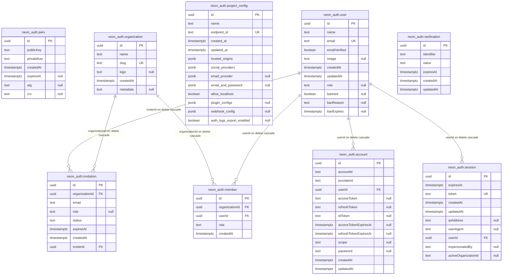

## 3. PostgreSQL and Neon audit

Severity: **P0** active data loss or breach; **P1** fix before new code; **P2** fix with the next change in that area; **P3** record and revisit. **There is no P0.** Confidence: *confirmed* = read directly in catalog or code; *likely* = follows from documented PostgreSQL behaviour but was not reproduced; *needs production stats*.

The database is small (largest table: `transit.revision_member`, about 1.5 MB, an estimated 17,927 rows). Index findings are about growth, not a current slowdown.

### 3.1 Integrity and concurrency

| ID | Sev | Evidence | Query path affected | Recommendation | Confidence |
|---|---|---|---|---|---|
| C1 | **P1** | `transit.admin_publish_revision` (0027:50) compares the pointer with the page's `p_expected_published` and checks the membership hash, but never compares the draft's `parent_revision_id` with the pointer. No code checks it either (`parent` in `src/domain/admin` and `src/server/admin` is display and the 50 m move warning only). Importers publish on their own (`scripts/lib/modes-writer.ts:84`, `scripts/lib/lines-writer.ts:78`). | An admin opens draft D from A; `pnpm db:import --commit` publishes B; the admin reloads, validates and publishes D. B's changes vanish silently, because D is a full snapshot of A. A rollback while a draft is open has the same shape. | In `mode = 'publish'`, refuse when `parent_revision_id` is distinct from the pointer, with a "recreate the draft" message. Make the CLI importers refuse while a draft is open. | confirmed by reading; not executed |
| C2 | **P1** | `community.admin_moderate` refuses anything not `pending` or `human_review` (0025:816). `delete_post` and `delete_comment` accept only the author. `resolve_report` changes the report row only and has no audit call. | A moderator cannot take down a published post, comment or photo, so "actioned" on a report would have no effect. | New definer function for take-down (reason, audit, notice, appeal), used by the report queue. See §4.6. | confirmed |
| C3 | P2 | Lock order differs: `community.edit_post` locks the post (0017:263), then its versions; `community.admin_moderate` locks the version through `content_target` (0025:466), then updates the post (0025:507). | An author edits while a moderator decides the same post. PostgreSQL aborts one with 40P01, which neither `src/server/api/http.ts:122-135` nor `adminProblem` maps: 500. | Lock the post row first in `content_target`. Map 40P01 and 40001 to 503 with `Retry-After`. | order confirmed; deadlock likely |
| C4 | P2 | `community.toggle_reaction` recounts with `set helpful_count = (select count(*) ...)` (0017:438, 0017:442) in READ COMMITTED, without first locking the target row. | Two riders mark the same post helpful at once. The second statement waits on the row but keeps its older snapshot, so it can store a count that misses the first reaction. The next toggle heals it. | Lock the post or comment before inserting the reaction, or add and subtract 1. | likely |
| C5 | P2 | `create_post` (0017:215), `create_comment` and `submit_correction` check `client_request_id`, then insert. `toggle_bookmark` and `toggle_reaction` insert without `on conflict`. `guarded()` (`src/server/community/handlers.ts:46-56`) and `src/server/corrections/handlers.ts:114-117` do not handle 23505. | A double tap, or a retry that overlaps the first request, gets 500 instead of the stored result. `priv.submit_complaint` is handled (`src/server/complaints/handlers.ts:132`); `edit_post` is safe because it locks the post first. | `insert ... on conflict do nothing` plus re-select, or map 23505 to one retry. | likely |
| C6 | P2 | Storage calls run inside an open transaction: photo approval (`src/server/admin/review-repo.ts:98-108`) and retention (`src/server/complaints/retention.ts:58-70`). No request timeout was found in `src/server/storage/adapter.ts`. | A slow bucket holds the row lock and one of 10 pool connections; only `idle_in_transaction_session_timeout` (5 min) ends it. Deliberate (rows and objects together) and low volume. | Keep the design; add a storage timeout of a few seconds. | confirmed |
| C7 | P3 | `community.admin_review_correction` locks the correction (0025:197), then the draft (0025:242). An accept with a stop action locks the draft first (`reviewCorrection` in `src/server/admin/review-repo.ts`). | Two reviewers on the same report can deadlock; one gets 500. | Lock the draft first in both paths, or rely on the C3 mapping. | order confirmed; deadlock likely |
| C8 | P3 | `saved-trips/route.ts:92` and `saved-places/route.ts:61` (both under `src/app/api/v1/me/`) upsert in payload order. | Two devices of one user syncing in a different order can deadlock. | Sort by id before writing (Q1 also solves it). | likely |
| C9 | P3 | `priv.review_complaint` alerts only when the count is exactly 31 (0026:128). | Two concurrent opens at 29 each see 30; the next open sees 32, so the alert is skipped. | Alert at 31 or more when none was recorded in 24 h. | likely |

### 3.2 Foreign keys

| ID | Sev | Evidence | Query path affected | Recommendation | Confidence |
|---|---|---|---|---|---|
| F1 | P2 | `core.saved_trip.revision_id` references `transit.revision`, and the value comes from the phone (`src/app/api/v1/me/saved-trips/route.ts:92-135`). 23503 is not handled. | One trip with an unknown revision (for example saved on a preview database) fails the whole batch of up to 50 with 500, on every sync. | Reject only the bad trip. Consider dropping the key: the row already stores the label, kind and publish date, and the key blocks any future pruning of revisions. | confirmed by reading |
| F2 | P3 | `transit.barangay.source_code` and `transit.route_alias.source_code` are scalar text with no key; five other scalar source columns have one. | An import with a misspelled source code is accepted, and `v_published_sources` omits it. | Add the two keys (`not valid`, then `validate`). | confirmed |
| F3 | P3 | `transit.fare_observation.destination_code` has no key, and `publish_revision` checks only `regional_service_version.destination_codes`. (`terminal_code` and `fare_rule_codes` are checked at publish.) `community.post.route_code` is checked by pattern only (0017:32). | A regional fare can name a destination that does not exist; a post can name a route that does not exist. | Key to `regional_destination(code)`, or add the publish check. Leave `route_code` loose unless posts get filtered by route. | confirmed |
| F4 | P3 | `community.post.published_version_id` references `post_version(id)` alone. | Nothing in the database stops a post from pointing at another post's version. The functions set it correctly. | Composite key (`published_version_id`, `id`) to `post_version(id, post_id)`. | confirmed |
| F5 | P3 | `community.correction.media_ids uuid[]` (spec 04 §4.4 says such arrays become join tables). `core.admin_review_media` filters with `any (c.media_ids)` (0025:935), which no index serves. | Each reviewer photo view scans `correction`. No retention path covers correction photos. | Join table `correction_media` when correction retention or account deletion is built. | confirmed |
| F6 | P3 | 41 text user-id columns have no key (Appendix D). For `core.preference`, `user_role`, `ack`, `saved_place`, `saved_trip`, `step_up` and `media_object`, a key to `core.profile(user_id)` is possible. | Account deletion has no enforced list of dependants. | Decide with account deletion (§4.6). Keep `priv` without a key: spec 04 §4.8 replaces `reporter_id` with a tombstone. | confirmed |
| F7 | info | Impossible by design: `revision_member`, all `target_type` pairs, `audit_event`, every `source_codes` array, `stop_measures` jsonb, and anything pointing at `neon_auth`. | none | No action. | confirmed |
| F8 | info | `community.appeal.decision_id` and `moderation_decision.appeal_id` form a cycle; `post` and `post_version` too. Neither is deferrable; the functions insert, then update. | Hard deletes must null one side first. | Remember it in account deletion. | confirmed |

### 3.3 Indexes

| ID | Sev | Evidence | Query path affected | Recommendation | Confidence |
|---|---|---|---|---|---|
| I1 | P2 | `community.reaction` has only the primary key (`user_id`, `target_type`, `target_id`). | `toggle_reaction` counts by target, so each tap scans all reactions. PostgreSQL 18 skip scan does not help with many users. | Index (`target_type`, `target_id`). | confirmed |
| I2 | P2 | `community.content_report` is unique on (`reporter_id`, `target_type`, `target_id`) plus a partial index on `created_at`. | `admin_moderation_queue` counts open reports per queue row (0025:716, 0025:730): open reports × queue rows. Reports cannot be resolved today, so the open set only grows. | Partial index (`target_type`, `target_id`) where `status = 'open'`. | confirmed |
| I3 | P2 | `priv.evidence_access.complaint_id` (cascading key) has no index; `accessor_id` and `media_object_id` do (0018:111-112). | `review_complaint` (last 50 by complaint), `retention_purge_complaint` (0026:320), and the cascade. | Index (`complaint_id`, `issued_at desc`). | confirmed |
| I4 | P3 | `community.moderation_decision`: the history reads `order by created_at desc limit 50` (`admin_moderation_queue`); existing indexes lead with the target or `decided_by`. | Moderation page. | Index on `created_at desc`; see I7 for the decider index. | confirmed |
| I5 | P3 | Keys with no usable index (Appendix A): `bookmark.post_id`, `comment.parent_comment_id`, `post.published_version_id`, `correction.entity_revision_id`, `correction.incorporated_revision_id`, `saved_trip.revision_id`, `batch.source_document_id`, `source_document.source_code`, `place_version.source_code`, `shape_version.road_source_code`, `walk_graph_version.road_source_code`, `revision.parent_revision_id`, `published_pointer.revision_id`. `comment.post_id` has only a partial index on live rows. | Nothing deletes those parents today, so there is no current cost. | Add `bookmark.post_id` and `comment.parent_comment_id` with account deletion; leave the rest. | confirmed |
| I6 | P3 | 13 indexes are a prefix of a unique index on the same table: `saved_place_user_idx`, `saved_trip_user_idx`, `eta_param_version_param_idx`, `place_version_place_idx`, `regional_service_version_service_idx`, `route_cooperative_route_idx`, `route_fare_observation_route_idx`, `route_note_route_idx`, `route_operating_status_route_idx`, `route_vehicle_class_route_idx`, `shape_version_shape_idx`, `terminal_version_terminal_idx`, `walk_graph_version_graph_idx`. | Extra write work only. | Drop together, later. | confirmed |
| I7 | P3 | No query found in `src`, `scripts` or function bodies can use these: `post_version_tags_idx` (the feed filters `tag = any (v.tags)`, `src/server/community/read.ts:114`, which GIN cannot serve), `place_version_geog_idx`, `terminal_geog_idx`, `terminal_version_geog_idx` (the only spatial predicate is `ST_DWithin` in `admin_reconciliation`, on stop versions), `audit_event_entity_idx`, `evidence_access_accessor_idx`, `moderation_decision_decider_idx`. | `audit_event` pays for the extra index on every audited action. | Check `pg_stat_user_indexes` in production, then drop, or rewrite the tag filter as `v.tags @> array[tag]`. | needs production stats |
| I8 | P3 | Unindexed sorts and filters: `ops.job` by `created_at desc` (`src/server/admin/system-handlers.ts:248`); closed complaints (`priv.review_list`, `retention_due` 0026:281) because `complaint_queue_idx` covers only open ones; `media_object` by (`purpose`, `created_at`) in `retention_due`; closed corrections by `updated_at`. | Admin pages and the daily job only. | Add when the tables pass a few thousand rows. | confirmed |
| I9 | P3 | Feed search is `ilike '%q%'` on title and body (`read.ts:117`). `pg_trgm` is installed and no index uses it. | Community search scans published posts. | Trigram index on published versions when posts number in the thousands. | confirmed |
| I10 | info | `scripts/migrate.ts` wraps each file in a transaction, so `create index concurrently` cannot run in a migration. | Future indexes on large tables. | Fine at today's size; extend the runner before a table grows. | confirmed |

### 3.4 N+1 and expensive queries

| ID | Sev | Evidence | Query path affected | Recommendation | Confidence |
|---|---|---|---|---|---|
| Q1 | P2 | Saved sync runs one `insert ... on conflict` per item, up to 50 sequential round trips in one transaction (`saved-trips/route.ts:92`, `saved-places/route.ts:61`), and the phone re-uploads everything on each sync (`src/client/saved/sync.ts:56-61`). | POST `/api/v1/me/saved-*`. | One statement with `jsonb_to_recordset`; send only changed items. | confirmed |
| Q2 | P2 | `transit.admin_revisions` runs a member count per revision, plus `revision_membership_hash` for each validated one (0023:146), and is called with 100 (`src/server/admin/repo.ts:62`). | `/admin/revisions` re-reads and re-hashes the members of up to 100 revisions per load; the cost grows with each publication. | Hash only drafts and the published revision; membership is frozen for the others. | confirmed |
| Q3 | P3 | `admin_moderation_queue` builds JSON with subqueries for every pending row before `limit`. | Moderation page; every post is pending while auto-publish is off. | Limit ids per branch first. | confirmed |
| Q4 | P3 | `v_published_sources` is a UNION of 26 branches over other views, read by `network-repo.ts:820`, `reference-repo.ts:58` and `intercity-repo.ts:71` (in `src/server/repos/`). | Route, terminal and intercity detail on a CDN miss. | Measure first; a code filter on the base tables would be cheaper. | needs production stats |
| Q5 | P3 | Thread comments have no limit (`src/server/community/read.ts:186-196`). | One very long thread. | Page comments. | confirmed |
| Q6 | P3 | A community post can open four transactions: session (`src/server/auth/session.ts:57`), gate (`src/server/community/handlers.ts:107`), Jev budget (`src/server/adapters/jev/client.ts:101`) and write (`handlers.ts:115`), each with `begin`, `set_config` and `commit`. No nested one was found, so the pool should not deadlock on itself. | Every authenticated write. | Accept: the split keeps Jev and Google calls out of transactions. | confirmed |
| Q7 | P3 | `ingest.admin_import_commit` loops per changed pin (limit 2,000) and grows a jsonb object by concatenation. `admin_repoint_stop` loops over variants and shapes. | Admin import; 128 pins today. | Fine at this size. | confirmed |
| Q8 | P3 | On a cold instance, requests that share the in-flight load (`src/server/repos/network-cache.ts:46`, `:64`) keep their own connection in an open read transaction while they wait. | Plan requests right after a deploy or a publication: up to 10 idle connections per instance. | Await a load already in flight before opening the transaction. | likely |
| Q9 | info | No per-row query loop was found in `src/server/repos`; the `for` loops there group rows in memory. `sweep_orphan_media` and retention use one transaction per item on purpose. | none | No action. | confirmed |

### 3.5 Operations, limits, retention

| ID | Sev | Evidence | Query path affected | Recommendation | Confidence |
|---|---|---|---|---|---|
| O1 | **P1** | **Nothing in the repo would purge most of `ops.rate_limit_bucket`, even with cron scheduled.** The purge lives in job kind `retention_purge` (`src/server/jobs/handlers.ts:18-25`), and the only `enqueueJob` call is `sweep_orphan_media` (`src/app/api/cron/jobs/route.ts:44`). The Places sweep deletes only keys starting `places:` (`src/server/repos/places-guard-repo.ts:31`); the other keys are plain SHA-256. | One row per key per window stays for ever (a guest plan makes a minute row and a day row), and guest keys derive from IP addresses. Spec 04 §4.4 says purged hourly. | Enqueue `retention_purge` next to the media sweep (code only). | confirmed |
| O2 | **P1** | `vercel.json` has no `crons`. | Orphan uploads are not swept, evidence retention does not run, jobs do not drain. The privacy text promises deletion after 365 days; driver reports are off (`DRIVER_REPORTS_ENABLED`). A schedule outside the repo was not checked; the handoff says there is none. | Owner decision: daily Vercel cron or a Neon schedule, before driver reports are enabled. | confirmed in repo |
| O3 | P2 | `statement_timeout = 0`, `lock_timeout = 0`, `idle_in_transaction_session_timeout = 5 min`, and no role-level settings for the app roles. The pool sets none (`src/server/db/client.ts:12-18`). | A slow query or a blocked lock holds a pool slot until the function is killed; 10 of those stop the instance. | `alter role paranaga_app set statement_timeout` and `lock_timeout` (for example 15 s and 5 s), tested through the pooled endpoint. Check production settings first. | confirmed on the branch |
| O4 | P2 | No retention for finished `ops.job` rows, rejected `core.media_object` rows or old `core.step_up` rows (one per session). `core.audit_event` grows by design with four secondary indexes; `revision_member` gains a full copy per draft. | Slow growth; admin pages in I8 and Q2. | Purge finished jobs after 30 days and rejected slots after 7; decide an audit retention period. | confirmed |
| O5 | P3 | Admin actions and the MyNaga handoff take the rate token inside the business transaction (`limited()` in `src/server/admin/handlers.ts`). | A failed action rolls its token back, so failures are not counted; the counter row stays locked for the action (validation, photo copy). Per user only. | Take the token in its own transaction, as plan, community and step-up already do. | confirmed |
| O6 | P3 | Single hot rows: `ops.places_daily_usage` (one per day) and the Jev day bucket. Updates are short, and no external call happens while they are held. Guests behind one carrier address share a key. | Serialised for a few milliseconds. | None now. | confirmed |
| O7 | P3 | All advisory locks share one 32-bit `hashtext` space, including the map id sent by the admin importer. | A collision would only make two unrelated jobs wait. | Use the two-key form when adding locks. | confirmed |
| O8 | P3 | `ops.claim_jobs` does not cap attempts (0014:75); the worker does (`src/server/jobs/worker.ts:138`). | Any other worker would retry a crashing job for ever. | Move the cap into SQL when the function is next changed. | confirmed |

### 3.6 RLS and privileges

| ID | Sev | Evidence | Query path affected | Recommendation | Confidence |
|---|---|---|---|---|---|
| S1 | P2 | `grant select, update on core.profile to paranaga_app` (0000:409) covers every column; the policy (0000:461) only checks the owner. | No code updates `profile` today, but a future "edit profile" statement could let a user clear their own `suspended_until` or `deleted_at`. `media_object` already uses column grants. | Replace with `update (display_name, locale)`. | confirmed |
| S2 | P3 | The `ops.job` UPDATE policy is `using (true)` with a table-wide grant (0000:417, 0000:503). Only the enqueue upsert needs it. | The app role could rewrite any job. | Grant `update (run_after)` only. | confirmed |
| S3 | P3 | Superseded functions still executable by the app and called by nothing: `community.content_review_queue`, `community.review_queue`, `priv.review_queue` (returns complaint text; needs the role and step-up). | Extra surface on private data. | Revoke, as 0030 did for two others. | confirmed |
| S4 | info | Policy cost: app policies wrap `current_user_id()` and `has_role()` in a subselect, so they run once per statement. Per-row functions appear only on import and purge paths (`in_released_revision`, `complaint_purgeable`). | none | No action. | confirmed |

### 3.7 What is good

- RLS is enabled and forced on all 89 app tables. All 81 definer functions pin `search_path` with `pg_temp` last, and none is executable by PUBLIC.
- Publishing is serialised: advisory lock, pointer `for update`, revision `for update`, a partial unique index as backstop, and a membership hash bound to the validation.
- The stop editor uses optimistic versions (409 on a stale page); the complaint status change supports the same since 0030.
- Job claiming uses `for update skip locked`, a lease, a heartbeat and a partial index; rate tokens are one atomic upsert and stop writing once the limit is reached.
- Public reads use one REPEATABLE READ read-only transaction and an in-memory snapshot per revision. External calls stay outside transactions except C6.
- The app uses the pooled URL with transaction-local settings and transaction-level advisory locks only; the session lock in `scripts/migrate.ts` uses the unpooled URL. `attachDatabasePool` closes idle clients, and pool waits answer 503 with `Retry-After`.

## 4. Alignment check

### 4.1 Drizzle `src/server/db/schema.ts` against the catalog

51 tables and 496 columns are mirrored. **No mirrored table or column is missing from the database, and no NOT NULL flag differs.** Only three tables are actually imported: `profile` and `userRole` (`src/server/auth/session.ts`) and `savedPlace` (`saved-places/route.ts`). Everything else is raw SQL, so the rest of the file is documentation that has aged.

- **Wrong types (6):** `shape_version.geog` is declared `Point`, real `LineString`. `saved_place.point`, `saved_trip.start_point` and `saved_trip.dest_point` are declared `text`, real `geography(Point,4326)`. `raw_feature.lon` and `lat` omit the (11,8) precision.
- **Missing columns (61), notably:** `correction.draft_revision_id`, `draft_change`, `reviewed_by`, `reviewed_at`, `location`; `stop_point_version.name`, `aliases`, `edit_note`; six `regional_service_version` status and destination columns; `revision.validation_report`, `last_edited_by`, `parent_revision_id`; `user_role.revoked_by`; `complaint.incident_location`.
- **Missing tables (38):** `ingest` 6, `core` 4 (`ack`, `audit_event`, `role`, `step_up`), `community` 4 (`appeal`, `jev_evidence`, `moderation_decision`, `post_photo`), `ops` 5, `transit` 19.
- **Recommendation:** cut the file to the three used tables. A partial mirror that claims to be in sync is a trap. No migration.

### 4.2 Repo SQL and API schemas against columns

- **SQL identifiers:** 227 SQL segments in `src` and `scripts` were scanned; every identifier resolves to a catalog name, a column alias, a SQL word or text cut by the scanner. **No missing or renamed column was found.** This is a name scan, not `prepare`; dynamic fragments are covered only by the integration tests.
- **Value sets:** 75 CHECK lists match a list in the code exactly. The other 20 were read by hand: they are sets written only in SQL or import code, or code subsets (for example `content_report.status`, which no code reads). `comment.moderation_status` has no `superseded`; the shared code type has it. Harmless.
- **Lengths:** Zod limits equal the CHECK limits for post title (5 to 120), post body (10 to 2,000), comment (2 to 600), report note (300), appeal note (10 to 1,000), and saved labels and ids. The spec says 4,000 and 1,000 for post and comment: the code and database agree, the spec is stale.
- **Media:** a photo slot accepts 25 MB (`create_media_slot`, `createMediaSlotPayloadSchema`), although `MAX_PHOTO_BYTES` is 10 MB. Code fix, no migration.
- **Saved trips:** the request body is capped at 128 KB for up to 50 trips (`saved-trips/route.ts:80`), and each trip carries its option, stops and variants. A user with a few dozen trips may exceed it, and the sync would then fail every time. Likely; measure real payloads. No migration.

### 4.3 Orphans and unreachable values

Search used: word match of each name in 546 `.ts/.tsx/.mjs/.js/.sh/.ps1/.py` files under `src` and `scripts` (comments stripped, `schema.ts` excluded), in all 106 function bodies, 31 view definitions and 316 policies. Common words can hide an orphan, so this list is a minimum.

| Object | State | Suggestion |
|---|---|---|
| `ops.moderation_policy` | Never referenced; the policy lives in `src/domain/moderation/policy.ts` and `JEV_POLICY_VERSION` | Drop or adopt |
| `ingest.error` | Never referenced | Drop, or write import errors to it |
| `core.preference` | A row is created at sign-up; its settings are never read or written by the app (preferences live on the phone) | Keep only if sync is planned |
| `core.profile.locale`, `deleted_at` | Never read or written | Keep for Bikol and account deletion |
| `core.profile.suspended_until` | Read by `has_role` and the session; nothing sets it | Needs a suspension function |
| `core.saved_trip.invalidated_at` | Read; nothing sets it | Needs `publish_followups`, or removal |
| `transit.rail_status`, `provider_presence` | Written by the first import and kept as members; no API reads them | Keep as provenance |
| Columns with no match: `ack.accepted_at`, `conflict.resolution`, `source_document.storage_key`, `complaint_media.gps_accuracy_m`, `stop_point.official_stop_id` | Written by default or never | Keep or drop with the next change |
| `priv.complaint_media.redacted_key` | Purged when present; nothing writes it | Keep for redacted copies |
| `community.report_queue`, `community.resolve_report` | Executable by the app; no route | Wire up (§4.6) |
| `community.content_review_queue`, `community.review_queue`, `priv.review_queue` | Superseded | Revoke (S3) |
| `community.set_content_status`, `community.set_correction_status` | App grant removed in 0030, kept | Drop later |
| Job kinds `retention_purge`, `expire_disruptions` | Registered, never enqueued; the second is an empty stub and there is no `disruption` table | O1; remove the stub |

**Values in a CHECK that no code path writes:** `revision.status = validating`; `complaint.status = withdrawn`; `correction.status = draft, superseded`; `post_version` and `comment` `moderation_status = human_review`; `content_report.status = actioned, dismissed`; `media_object.status = deleted` (the definer policy allows only `verified` and `rejected`); `post.label = official_notice, incorporated_change`; `stop_point_version.status = published, temporary, relocated` from the admin functions. **One-way states:** `correction.needs_evidence` and `complaint.needs_information` have no function for the reporter to answer.

### 4.4 Spec 04 against reality

| Spec 04 | Reality |
|---|---|
| `transit.agency`, `operator`, `mode`, `stop_area`, `terminal_bay`, `terminal_entrance`, `walk_edge`, `barrier`, `discount_rule`, `fare_matrix_row`, `service_window`, `disruption`, `landmark`, `landmark_alias` | Not built (C4 to C7 deferred; OSM places stand in for landmarks; the walk graph is one stored payload) |
| `v_candidate_pins`, `transit.f_norm`, `geom_utm` columns, trigram indexes, the fare `EXCLUDE` constraint | Not built. Candidates show through `v_published_stops`; search runs on the device |
| `core.trip_history`, `community.comment_version`, `user_restriction`, `changelog_entry`, `priv.jev_complaint_evidence`, `priv.v_complaint_review` | Not built. Definer functions replace the view |
| `audit_event` and `job` ids are UUIDv7 | Both default to `gen_random_uuid()` |
| `saved_place.landmark_id`; `saved_trip.legs`; `post_version.media_ids`; `appeal.outcome`; `jev_evidence.answers`, `usage` | Replaced by `source`; `option`, `stops`, `variants`; `post_photo`; `status`; typed columns only |
| `complaint.route_id`, `direction`; `external_handoff.event`, `self_reported_status` | Not stored |
| `evidence_link.service_window_id`, `walk_edge_id` | Not there (no such tables) |
| `contributor` granted automatically after 24 h | Not built; only `core.grant_role` by an admin |

### 4.5 Logical references with no key

The 98 dashed lines in §2: 37 from `revision_member`; 23 source code columns; the polymorphic `community` targets; code lookups (`terminal_code`, `fare_rule_codes`, `destination_codes`, `destination_code`, `candidate_terminal_code`, `route_code`); `source_identity` in `ingest`; `media_ids`; `stop_measures`; correction `entity_id`; and the main user-id columns (all 41 are in Appendix D).

### 4.6 Upcoming work and open items

| Item (source) | Migration needed |
|---|---|
| Stale draft guard (C1) | Yes: replace one function |
| Content reports cannot be resolved (handoff) | For resolve alone: **none** (functions and grant exist), but add an audit call. For a meaningful "actioned": yes, take-down (C2) |
| Public photo copy stays after post deletion (handoff). The app answers 404 after deletion, but the object and the private original remain | Yes: a removed state for `post_photo` (its CHECK ties `published` to the public key), a definer list and mark function, a definer delete path on `media_object` for `community_photo`, and a job |
| `withdrawn` unreachable (handoff) | Yes: an owner-only withdraw function that writes the event and `retention_until`. The purge already covers the status |
| Reporter answers `needs_evidence` / `needs_information` (§4.3) | Yes: one function each, with new evidence links |
| Unscheduled cron (handoff) | None (`vercel.json` or a Neon schedule, plus O1) |
| Bikol (i18n plan) | None for the interface; `profile.locale` already allows `bcl`. `route_note.text` and dataset notes are single-language: yes only if server text is translated |
| `better-auth` advisories (handoff) | None. After an upgrade, check that `neon_auth."user"` keeps `id`, `name`, `email`, `emailVerified`: two definer functions read them, and both handle a missing table but not a renamed column (42703) |
| `contributor` auto-grant, user restrictions, suspension (spec 04; 07 N6 "Not built") | Yes: functions, and a `user_restriction` table or a setter for `suspended_until` |
| Account deletion and export (spec 05 §5.9) | Yes: tombstones, F6, the cycles in F8, I5 indexes |
| Public changelog of incorporated corrections (07 N6) | Yes: one table, or use `post.label = incorporated_change` |
| Admin break-glass, redacted copies, dead-job requeue, alerts (07 §7.12) | Yes: functions; `evidence_access` CHECKs (`accessor_role`, `purpose`) must widen; requeue needs a definer function |
| C4 to C7: shapes, terminals, fares, service windows, disruptions (07 §7.11, deferred) | Yes: new tables as in spec 04, new `entity_kind` values in one CHECK plus the two functions that switch on the kind (`publish_revision`, `admin_validation_facts`), `evidence_link` targets, and definer grants. `shape_version` CHECKs force `approximate` and the fixed label, so a reviewed shape needs them relaxed |
| Intercity IC2 stewardship (2026-10-28 design) | Yes: admin edit functions (mostly on existing tables), new `correction.kind` and `entity_type` values |
| Intercity IC3 geography | Yes: the CHECK `geog IS NULL` on `regional_destination_version` becomes a Bicol envelope; the terminal envelope widens for points outside the city |
| Intercity IC4, AR X0 to X5 (07 §7.13) | None (device and existing snapshot) |
| V1 trip preview (07 §7.13) | Unknown until scoped; contributed images would need a media purpose and rights fields |
| Lunad rename | None. `ingest.source` is append-only, so titles stay a display concern. Role names `paranaga_*` stay |
| 4 integration tests with old counts; RT33 and U05 rights records (handoff) | None (tests and a data file) |

## 5. Proposed migrations (words only)

Forward-only, one file each, in this order. 0031 to 0035 are applied (see §1.5); the rest are proposals without SQL.

| Order | Proposal | Findings | Risk |
|---|---|---|---|
| 0031 (applied) | Replace `admin_publish_revision` with the parent check. Decide the message and whether an override exists | C1 | Low: one function. It blocks a draft that predates a rollback, which is the point |
| 0032 (applied) | Take-down function, audit in `resolve_report`, post-first lock order in `content_target`; `toggle_*` with `on conflict` and a locked or incremental count | C2 to C5 | Medium: moderation behaviour changes; needs RLS tests for every role |
| 0033 (applied) | Two small indexes: evidence access by complaint, decisions by date (I1 and I2 are in 0032) | I3, I4 | Low: tiny tables |
| 0034 (applied) | Narrow grants: `profile` columns, `ops.job` column, revoke three dead functions | S1 to S3 | Low: no code was found that depends on them |
| 0035 (applied) | Role timeouts for `paranaga_app`; none for the import role | O3 | Medium: a value that is too short breaks revision validation; try it on a branch through the pooler first |
| 0036 | Photo removal states and functions | §4.6 | Medium: touches the delete policy on `media_object` |
| 0037 | Withdraw and answer functions for reporters | §4.6 | Medium: personal data; needs a security review |
| later | Account deletion with F5, F6, I5; keys F2 to F4; drop indexes I6 and I7 after production statistics; drop `moderation_policy`, `ingest.error` and legacy functions | as listed | Dropping is irreversible: backup branch first |

Every migration: a backup branch, `pnpm db:check-rls`, and integration tests through `scripts/with-neon-branch.sh`.

## 6. Before new code

Items 1 to 8 are done as of 2026-11-24, except refreshing spec 04 (item 8).

1. **Approve or correct this document** (remove the AI draft mark).
2. **C1:** stop a stale draft from overwriting a newer publication. Until then: no publishing CLI import while an admin draft is open.
3. **O1 and O2:** enqueue the rate-limit purge (code) and choose a cron schedule (owner).
4. **C2:** decide the take-down rule for published content, then build it with report resolution.
5. **Map database conflicts to answers:** 40P01 and 40001 to 503, 23505 to a retry, 23503 in saved trips (C3, C5, F1; code only).
6. **I1 to I3** and **S1:** small migrations, cheap now.
7. **O3:** set timeouts after checking production settings.
8. **Cut `schema.ts`** to the three tables in use, and refresh spec 04 from §4.4.

Product decisions needed from the owner: take-down and report handling; photo removal after deletion; withdraw and answer flows; audit and job retention periods; the cron host.

## Appendix A. Foreign keys and their delete rule

No foreign key is deferrable, and all are validated. A key is "partial" when its only index has a `WHERE fk IS NOT NULL` style predicate, which still serves the delete check, unless §3 says otherwise.

| Child | Columns | Parent | On delete | Index leading with the FK columns |
|---|---|---|---|---|
| community.appeal | decision_id | community.moderation_decision (id) | no action | `appeal_decision_id_key` |
| community.appeal | resolution_decision_id | community.moderation_decision (id) | no action | `appeal_resolution_idx` |
| community.bookmark | post_id | community.post (id) | cascade | **none** |
| community.comment | parent_comment_id | community.comment (id) | no action | **none** |
| community.comment | post_id | community.post (id) | cascade | `comment_post_idx` (partial) |
| community.correction | draft_revision_id | transit.revision (id) | no action | `correction_draft_idx` (partial) |
| community.correction | duplicate_of | community.correction (id) | no action | `correction_duplicate_idx` (partial) |
| community.correction | entity_revision_id | transit.revision (id) | no action | **none** |
| community.correction | incorporated_revision_id | transit.revision (id) | no action | **none** |
| community.correction_event | correction_id | community.correction (id) | cascade | `correction_event_idx` |
| community.moderation_decision | appeal_id | community.appeal (id) | no action | `moderation_decision_appeal_idx` (partial) |
| community.post | published_version_id | community.post_version (id) | no action | **none** |
| community.post_photo | media_object_id | core.media_object (id) | no action | `post_photo_media_object_id_key` |
| community.post_photo | post_id | community.post (id) | cascade | `post_photo_post_id_position_key` |
| community.post_version | post_id | community.post (id) | cascade | `post_version_post_id_n_key` |
| core.saved_trip | revision_id | transit.revision (id) | no action | **none** |
| core.user_role | role_code | core.role (code) | no action | `user_role_role_idx` (partial) |
| ingest.batch | source_document_id | ingest.source_document (id) | no action | **none** |
| ingest.change | batch_id | ingest.batch (id) | no action | `change_batch_id_source_identity_key` |
| ingest.conflict | batch_id | ingest.batch (id) | no action | `conflict_batch_id_kind_refs_key` |
| ingest.error | batch_id | ingest.batch (id) | no action | `error_batch_idx` |
| ingest.raw_feature | batch_id | ingest.batch (id) | no action | `raw_feature_batch_id_source_identity_key` |
| ingest.raw_feature_lineage | stop_point_id | transit.stop_point (id) | no action | `raw_feature_lineage_stop_idx` |
| ingest.source_document | source_code | ingest.source (code) | no action | **none** |
| priv.complaint_event | complaint_id | priv.complaint (id) | cascade | `complaint_event_idx` |
| priv.complaint_media | complaint_id | priv.complaint (id) | cascade | `complaint_media_complaint_idx` |
| priv.complaint_media | media_object_id | core.media_object (id) | no action | `complaint_media_media_object_id_key` |
| priv.evidence_access | complaint_id | priv.complaint (id) | cascade | **none** |
| priv.evidence_access | media_object_id | core.media_object (id) | no action | `evidence_access_media_idx` |
| priv.external_handoff | complaint_id | priv.complaint (id) | cascade | `external_handoff_pkey` |
| transit.coverage_audit | barangay_id | transit.barangay (id) | no action | `coverage_audit_barangay_id_key` |
| transit.eta_param_version | eta_param_id | transit.eta_param (id) | no action | `eta_param_version_content_uq` |
| transit.evidence | media_object_id | core.media_object (id) | no action | `evidence_media_idx` |
| transit.evidence | source_code | ingest.source (code) | no action | `evidence_source_idx` |
| transit.evidence_link | evidence_id | transit.evidence (id) | no action | `evidence_link_evidence_idx` |
| transit.evidence_link | fare_rule_version_id | transit.fare_rule_version (id) | no action | `evidence_link_fare_uq` (partial) |
| transit.evidence_link | shape_version_id | transit.shape_version (id) | no action | `evidence_link_shape_uq` (partial) |
| transit.evidence_link | stop_point_version_id | transit.stop_point_version (id) | no action | `evidence_link_stop_uq` (partial) |
| transit.evidence_link | terminal_id | transit.terminal (id) | no action | `evidence_link_terminal_uq` (partial) |
| transit.evidence_link | variant_version_id | transit.variant_version (id) | no action | `evidence_link_variant_uq` (partial) |
| transit.fare_conflict | fare_observation_id | transit.fare_observation (id) | no action | `fare_conflict_observation_idx` |
| transit.fare_conflict | fare_rule_id | transit.fare_rule (id) | no action | `fare_conflict_fare_rule_id_fare_observation_id_key` |
| transit.fare_observation | fare_rule_id | transit.fare_rule (id) | no action | `fare_observation_rule_idx` |
| transit.fare_observation | regional_service_version_id | transit.regional_service_version (id) | no action | `fare_observation_regional_idx` (partial) |
| transit.fare_rule_version | fare_rule_id | transit.fare_rule (id) | no action | `fare_rule_version_rule_idx` |
| transit.place_version | place_id | transit.place (id) | no action | `place_version_content_uq` |
| transit.place_version | raw_feature_id | ingest.raw_feature (id) | no action | `place_version_raw_idx` |
| transit.place_version | source_code | ingest.source (code) | no action | **none** |
| transit.published_pointer | revision_id | transit.revision (id) | no action | **none** |
| transit.reconciliation_decision | kept_stop_point_id | transit.stop_point (id) | no action | `reconciliation_kept_idx` |
| transit.reconciliation_decision | revision_id | transit.revision (id) | no action | `reconciliation_revision_idx` |
| transit.reconciliation_decision | stop_point_a | transit.stop_point (id) | no action | `reconciliation_decision_stop_point_a_stop_point_b_key` |
| transit.reconciliation_decision | stop_point_b | transit.stop_point (id) | no action | `reconciliation_b_idx` |
| transit.regional_departure | regional_service_version_id | transit.regional_service_version (id) | no action | `regional_departure_version_idx` |
| transit.regional_destination_version | regional_destination_id | transit.regional_destination (id) | no action | `regional_destination_version_content_uq` |
| transit.regional_service_version | regional_service_id | transit.regional_service (id) | no action | `regional_service_version_content_uq` |
| transit.revision | parent_revision_id | transit.revision (id) | no action | **none** |
| transit.revision_member | revision_id | transit.revision (id) | no action | `revision_member_pkey` |
| transit.route_alias | route_id | transit.route (id) | no action | `route_alias_route_id_kind_alias_key` |
| transit.route_cooperative | route_id | transit.route (id) | no action | `route_cooperative_content_uq` |
| transit.route_fare_observation | route_id | transit.route (id) | no action | `route_fare_observation_content_uq` |
| transit.route_note | route_id | transit.route (id) | no action | `route_note_content_uq` |
| transit.route_operating_status | route_id | transit.route (id) | no action | `route_operating_status_content_uq` |
| transit.route_stop | stop_point_version_id | transit.stop_point_version (id) | no action | `route_stop_stop_idx` |
| transit.route_stop | variant_version_id | transit.variant_version (id) | no action | `route_stop_variant_version_id_seq_key` |
| transit.route_vehicle_class | route_id | transit.route (id) | no action | `route_vehicle_class_content_uq` |
| transit.shape | variant_id | transit.variant (id) | no action | `shape_variant_id_key` |
| transit.shape_version | road_source_code | ingest.source (code) | no action | **none** |
| transit.shape_version | shape_id | transit.shape (id) | no action | `shape_version_content_uq` |
| transit.shape_version | variant_version_id | transit.variant_version (id) | no action | `shape_version_variant_version_idx` |
| transit.stop_point_source | raw_feature_id | ingest.raw_feature (id) | no action | `stop_point_source_raw_idx` |
| transit.stop_point_source | stop_point_id | transit.stop_point (id) | no action | `stop_point_source_stop_idx` |
| transit.stop_point_source | stop_point_version_id, stop_point_id | transit.stop_point_version (id, stop_point_id) | no action | **none** |
| transit.stop_point_version | stop_point_id | transit.stop_point (id) | no action | `stop_point_version_stop_idx` |
| transit.terminal_version | terminal_id | transit.terminal (id) | no action | `terminal_version_content_uq` |
| transit.variant | route_id | transit.route (id) | no action | `variant_route_direction_kind_name_uq` |
| transit.variant_version | variant_id | transit.variant (id) | no action | `variant_version_variant_idx` |
| transit.walk_graph_version | road_source_code | ingest.source (code) | no action | **none** |
| transit.walk_graph_version | walk_graph_id | transit.walk_graph (id) | no action | `walk_graph_version_content_uq` |

## Appendix B. Secondary indexes

Every index that does not back a primary key or a unique constraint. All are valid and ready.

| Table | Index | Definition |
|---|---|---|
| community.appeal | `appeal_author_idx` | btree (author_id) |
| community.appeal | `appeal_open_idx` | btree (created_at) WHERE (status = 'open') |
| community.appeal | `appeal_resolution_idx` | btree (resolution_decision_id) |
| community.appeal | `appeal_target_idx` | btree (target_type, target_id, created_at DESC) |
| community.comment | `comment_post_idx` | btree (post_id, created_at, id) WHERE (deleted_at IS NULL) |
| community.comment | `comment_status_idx` | btree (moderation_status, created_at) WHERE ((moderation_status = ANY (ARRAY['pending', 'human_review'])) AND (deleted_at IS NULL)) |
| community.content_report | `content_report_open_idx` | btree (created_at) WHERE (status = 'open') |
| community.content_report | `content_report_open_target_idx` | btree (target_type, target_id) WHERE (status = 'open') |
| community.reaction | `reaction_target_idx` | btree (target_type, target_id) |
| community.correction | `correction_author_idx` | btree (author_id, created_at DESC) |
| community.correction | `correction_draft_idx` | btree (draft_revision_id) WHERE (draft_revision_id IS NOT NULL) |
| community.correction | `correction_duplicate_idx` | btree (duplicate_of) WHERE (duplicate_of IS NOT NULL) |
| community.correction | `correction_entity_idx` | btree (entity_type, entity_id) |
| community.correction | `correction_queue_idx` | btree (status, submitted_at) WHERE (status = ANY (ARRAY['submitted', 'under_review', 'needs_evidence'])) |
| community.correction_event | `correction_event_idx` | btree (correction_id, at) |
| community.moderation_decision | `moderation_decision_appeal_idx` | btree (appeal_id) WHERE (appeal_id IS NOT NULL) |
| community.moderation_decision | `moderation_decision_decider_idx` | btree (decided_by, created_at DESC) |
| community.moderation_decision | `moderation_decision_target_idx` | btree (target_type, target_id, created_at DESC) |
| community.post | `post_author_idx` | btree (author_id, seq DESC) WHERE (deleted_at IS NULL) |
| community.post | `post_feed_idx` | btree (seq DESC) WHERE ((published_version_id IS NOT NULL) AND (deleted_at IS NULL)) |
| community.post | `post_seq_idx` | unique btree (seq) |
| community.post | `post_topic_idx` | btree (topic, seq DESC) WHERE ((published_version_id IS NOT NULL) AND (deleted_at IS NULL)) |
| community.post_photo | `post_photo_pending_idx` | btree (created_at) WHERE (moderation_status = 'pending') |
| community.post_version | `post_version_one_live_idx` | unique btree (post_id) WHERE (moderation_status = 'published') |
| community.post_version | `post_version_request_idx` | unique btree (post_id, client_request_id) WHERE (client_request_id IS NOT NULL) |
| community.post_version | `post_version_status_idx` | btree (moderation_status, submitted_at) WHERE (moderation_status = ANY (ARRAY['pending', 'human_review'])) |
| community.post_version | `post_version_tags_idx` | gin (tags) |
| core.audit_event | `audit_event_action_idx` | btree (action, at DESC) |
| core.audit_event | `audit_event_actor_idx` | btree (actor_user_id, at DESC) |
| core.audit_event | `audit_event_at_idx` | btree (at DESC, id DESC) |
| core.audit_event | `audit_event_entity_idx` | btree (entity_type, entity_id) |
| core.media_object | `media_object_owner_idx` | btree (owner_id) |
| core.media_object | `media_object_slot_idx` | btree (created_at) WHERE (status = 'slot') |
| core.saved_place | `saved_place_user_idx` | btree (user_id) |
| core.saved_trip | `saved_trip_user_idx` | btree (user_id) |
| core.user_role | `user_role_active_uq` | unique btree (user_id, role_code) WHERE (revoked_at IS NULL) |
| core.user_role | `user_role_role_idx` | btree (role_code) WHERE (revoked_at IS NULL) |
| ingest.batch | `batch_one_commit_uq` | unique btree (snapshot_version) WHERE ((mode = 'commit') AND (status = ANY (ARRAY['running', 'committed']))) |
| ingest.error | `error_batch_idx` | btree (batch_id) |
| ingest.raw_feature | `raw_feature_identity_idx` | btree (source_identity) |
| ingest.raw_feature_lineage | `raw_feature_lineage_stop_idx` | btree (stop_point_id) |
| ops.job | `job_claim_idx` | btree (run_after) WHERE (status = ANY (ARRAY['queued', 'retry', 'running'])) |
| ops.job | `job_idem_uq` | unique btree (kind, idempotency_key) WHERE (status <> ALL (ARRAY['done', 'dead'])) |
| ops.moderation_policy | `moderation_policy_active_uq` | unique btree ((true)) WHERE active |
| ops.places_cache | `places_cache_expires_idx` | btree (expires_at) |
| ops.rate_limit_bucket | `rate_limit_window_idx` | btree (window_start) |
| priv.complaint | `complaint_queue_idx` | btree (queue, submitted_at) WHERE (status = ANY (ARRAY['submitted', 'under_review', 'needs_information'])) |
| priv.complaint | `complaint_reporter_idx` | btree (reporter_id, created_at DESC) |
| priv.complaint_event | `complaint_event_idx` | btree (complaint_id, at) |
| priv.complaint_media | `complaint_media_complaint_idx` | btree (complaint_id) |
| priv.evidence_access | `evidence_access_accessor_idx` | btree (accessor_id, issued_at DESC) |
| priv.evidence_access | `evidence_access_media_idx` | btree (media_object_id) |
| transit.eta_param_version | `eta_param_version_param_idx` | btree (eta_param_id) |
| transit.evidence | `evidence_media_idx` | btree (media_object_id) |
| transit.evidence | `evidence_source_idx` | btree (source_code) |
| transit.evidence_link | `evidence_link_evidence_idx` | btree (evidence_id) |
| transit.evidence_link | `evidence_link_fare_uq` | unique btree (fare_rule_version_id, evidence_id, claim) WHERE (fare_rule_version_id IS NOT NULL) |
| transit.evidence_link | `evidence_link_shape_uq` | unique btree (shape_version_id, evidence_id, claim) WHERE (shape_version_id IS NOT NULL) |
| transit.evidence_link | `evidence_link_stop_uq` | unique btree (stop_point_version_id, evidence_id, claim) WHERE (stop_point_version_id IS NOT NULL) |
| transit.evidence_link | `evidence_link_terminal_uq` | unique btree (terminal_id, evidence_id, claim) WHERE (terminal_id IS NOT NULL) |
| transit.evidence_link | `evidence_link_variant_uq` | unique btree (variant_version_id, evidence_id, claim) WHERE (variant_version_id IS NOT NULL) |
| transit.fare_conflict | `fare_conflict_observation_idx` | btree (fare_observation_id) |
| transit.fare_observation | `fare_observation_regional_idx` | btree (regional_service_version_id) WHERE (regional_service_version_id IS NOT NULL) |
| transit.fare_observation | `fare_observation_rule_idx` | btree (fare_rule_id) |
| transit.fare_rule_version | `fare_rule_version_content_uq` | unique btree (fare_rule_id, content_hash) WHERE (content_hash IS NOT NULL) |
| transit.fare_rule_version | `fare_rule_version_rule_idx` | btree (fare_rule_id) |
| transit.place_version | `place_version_geog_idx` | gist (geog) |
| transit.place_version | `place_version_place_idx` | btree (place_id) |
| transit.place_version | `place_version_raw_idx` | btree (raw_feature_id) |
| transit.reconciliation_decision | `reconciliation_b_idx` | btree (stop_point_b) |
| transit.reconciliation_decision | `reconciliation_kept_idx` | btree (kept_stop_point_id) |
| transit.reconciliation_decision | `reconciliation_revision_idx` | btree (revision_id) |
| transit.regional_departure | `regional_departure_version_idx` | btree (regional_service_version_id) |
| transit.regional_service_version | `regional_service_version_service_idx` | btree (regional_service_id) |
| transit.revision | `revision_one_published_uq` | unique btree ((true)) WHERE (status = 'published') |
| transit.revision_member | `revision_member_entity_idx` | btree (entity_id) |
| transit.revision_member | `revision_member_version_idx` | btree (version_id) |
| transit.route_cooperative | `route_cooperative_route_idx` | btree (route_id) |
| transit.route_fare_observation | `route_fare_observation_route_idx` | btree (route_id) |
| transit.route_note | `route_note_route_idx` | btree (route_id) |
| transit.route_operating_status | `route_operating_status_route_idx` | btree (route_id) |
| transit.route_stop | `route_stop_stop_idx` | btree (stop_point_version_id) |
| transit.route_vehicle_class | `route_vehicle_class_route_idx` | btree (route_id) |
| transit.shape_version | `shape_version_shape_idx` | btree (shape_id) |
| transit.shape_version | `shape_version_variant_version_idx` | btree (variant_version_id) |
| transit.stop_point_source | `stop_point_source_raw_idx` | btree (raw_feature_id) |
| transit.stop_point_source | `stop_point_source_stop_idx` | btree (stop_point_id) |
| transit.stop_point_version | `stop_point_version_content_uq` | unique btree (stop_point_id, content_hash) WHERE (content_hash IS NOT NULL) |
| transit.stop_point_version | `stop_point_version_geog_idx` | gist (geog) |
| transit.stop_point_version | `stop_point_version_stop_idx` | btree (stop_point_id) |
| transit.terminal | `terminal_geog_idx` | gist (geog) |
| transit.terminal_version | `terminal_version_geog_idx` | gist (geog) |
| transit.terminal_version | `terminal_version_terminal_idx` | btree (terminal_id) |
| transit.variant_version | `variant_version_content_uq` | unique btree (variant_id, content_hash) WHERE (content_hash IS NOT NULL) |
| transit.variant_version | `variant_version_variant_idx` | btree (variant_id) |
| transit.walk_graph_version | `walk_graph_version_graph_idx` | btree (walk_graph_id) |

## Appendix C. Functions

`D` = SECURITY DEFINER. Volatility: i immutable, s stable, v volatile. App / import = the runtime role may execute it. None is executable by PUBLIC.

| Function | D | Vol. | App | Import |
|---|---|---|---|---|
| community.add_post_photos (2 args) | D | v | yes |  |
| community.admin_corrections (2 args) | D | s | yes |  |
| community.admin_moderate (6 args) | D | v | yes |  |
| community.admin_moderation_queue (1 args) | D | s | yes |  |
| community.admin_resolve_appeal (4 args) | D | v | yes |  |
| community.admin_review_correction (8 args) | D | v | yes |  |
| community.apply_content_outcome (5 args) |  | v |  |  |
| community.assert_correction_reviewer (0 args) |  | s |  |  |
| community.assert_moderator (0 args) |  | s |  |  |
| community.block_author (2 args) | D | v | yes |  |
| community.content_review_queue (1 args) | D | s | yes |  |
| community.content_target (2 args) |  | v |  |  |
| community.create_comment (6 args) | D | v | yes |  |
| community.create_post (8 args) | D | v | yes |  |
| community.delete_comment (1 args) | D | v | yes |  |
| community.delete_post (1 args) | D | v | yes |  |
| community.edit_post (7 args) | D | v | yes |  |
| community.handle (1 args) |  | i | yes |  |
| community.incorporate_corrections (0 args) | D | v |  |  |
| community.record_jev_evidence (7 args) | D | v | yes |  |
| community.report_content (4 args) | D | v | yes |  |
| community.report_queue (1 args) | D | s | yes |  |
| community.resolve_report (2 args) | D | v | yes |  |
| community.review_queue (1 args) | D | s | yes |  |
| community.set_content_status (4 args) | D | v |  |  |
| community.set_correction_status (4 args) | D | v |  |  |
| community.submit_appeal (3 args) | D | v | yes |  |
| community.submit_correction (11 args) | D | v | yes |  |
| community.toggle_bookmark (1 args) | D | v | yes |  |
| community.toggle_reaction (2 args) | D | v | yes |  |
| community.unblock (1 args) | D | v | yes |  |
| core.admin_find_user (1 args) | D | v | yes |  |
| core.admin_review_media (1 args) | D | v | yes |  |
| core.admin_staff (0 args) | D | s | yes |  |
| core.assert_admin (0 args) |  | s |  |  |
| core.audit (4 args) | D | v | yes |  |
| core.bootstrap_admin (1 args) | D | v |  |  |
| core.create_media_slot (3 args) | D | v | yes |  |
| core.current_request_id (0 args) |  | s | yes |  |
| core.current_user_id (0 args) |  | s | yes | yes |
| core.ensure_commuter (1 args) | D | v | yes |  |
| core.find_orphan_media_slots (1 args) | D | s | yes |  |
| core.grant_role (3 args) | D | v | yes |  |
| core.has_role (1 args) | D | s | yes | yes |
| core.reject_media (1 args) | D | v | yes |  |
| core.revoke_role (3 args) | D | v | yes |  |
| core.step_up_apply (1 args) | D | v | yes |  |
| core.step_up_begin (1 args) | D | v | yes |  |
| core.step_up_finish (2 args) | D | v | yes |  |
| core.step_up_pending (1 args) | D | s | yes |  |
| core.user_roles_json (1 args) |  | s |  |  |
| core.verify_and_promote_media (6 args) | D | v | yes |  |
| ingest.admin_import_baseline (0 args) | D | s | yes |  |
| ingest.admin_import_batches (1 args) | D | s | yes |  |
| ingest.admin_import_commit (1 args) | D | v | yes |  |
| ingest.is_sorted_distinct (1 args) |  | i |  | yes |
| ops.claim_jobs (3 args) | D | v | yes |  |
| ops.finish_job (5 args) | D | v | yes |  |
| ops.heartbeat_job (3 args) | D | v | yes |  |
| ops.places_take_call (0 args) | D | v | yes |  |
| ops.purge_rate_limit_buckets (1 args) | D | v | yes |  |
| ops.take_token (3 args) | D | v | yes |  |
| priv.assert_complaint_reviewer (0 args) |  | s |  |  |
| priv.assert_system (0 args) |  | s |  |  |
| priv.complaint_purgeable (1 args) |  | s |  |  |
| priv.my_evidence_download (2 args) | D | v | yes |  |
| priv.require_step_up (0 args) |  | s |  |  |
| priv.retention_due (1 args) | D | s | yes |  |
| priv.retention_purge_complaint (1 args) | D | v | yes |  |
| priv.retention_purge_upload (1 args) | D | v | yes |  |
| priv.retention_record_run (5 args) | D | v | yes |  |
| priv.review_complaint (1 args) | D | v | yes |  |
| priv.review_list (2 args) | D | v | yes |  |
| priv.review_queue (1 args) | D | v | yes |  |
| priv.reviewer_evidence_download (2 args) | D | v | yes |  |
| priv.set_complaint_legal_hold (3 args) | D | v | yes |  |
| priv.set_complaint_status (6 args) | D | v | yes |  |
| priv.set_mynaga_handoff (3 args) | D | v | yes |  |
| priv.submit_complaint (14 args) | D | v | yes |  |
| priv.upload_purgeable (1 args) |  | s |  |  |
| transit.admin_assert_staff (0 args) |  | s |  |  |
| transit.admin_attach_stop_evidence (8 args) | D | v | yes |  |
| transit.admin_copy_stop_version (4 args) |  | v |  |  |
| transit.admin_coverage (1 args) | D | s | yes |  |
| transit.admin_create_draft (0 args) | D | v | yes |  |
| transit.admin_dashboard (0 args) | D | s | yes |  |
| transit.admin_draft_stop (2 args) |  | v |  |  |
| transit.admin_edit_stop (3 args) | D | v | yes |  |
| transit.admin_open_draft (0 args) |  | v |  |  |
| transit.admin_promote_stop (4 args) | D | v | yes |  |
| transit.admin_publish_revision (3 args) | D | v | yes |  |
| transit.admin_reconcile (7 args) | D | v | yes |  |
| transit.admin_reconciliation (0 args) | D | s | yes |  |
| transit.admin_record_validation (3 args) | D | v | yes |  |
| transit.admin_relocate_stop (5 args) | D | v | yes |  |
| transit.admin_repoint_stop (4 args) |  | v |  |  |
| transit.admin_retire_stop (3 args) | D | v | yes |  |
| transit.admin_revisions (1 args) | D | s | yes |  |
| transit.admin_stops (1 args) | D | s | yes |  |
| transit.admin_validation_facts (1 args) | D | v | yes |  |
| transit.in_released_revision (1 args) |  | s |  | yes |
| transit.publish_revision (1 args) | D | v |  | yes |
| transit.regional_child_running_guard (0 args) |  | v |  |  |
| transit.revision_member_guard (0 args) |  | v |  |  |
| transit.revision_membership_hash (1 args) |  | s |  |  |
| transit.stop_status_rank (1 args) |  | i |  |  |

## Appendix D. Text user-id columns without a foreign key

`community.appeal.author_id`, `community.appeal.original_decider`, `community.appeal.resolved_by`, `community.bookmark.user_id`, `community.comment.author_id`, `community.content_report.reporter_id`, `community.content_report.resolved_by`, `community.correction.author_id`, `community.correction.reviewed_by`, `community.correction_event.actor_id`, `community.moderation_decision.author_id`, `community.moderation_decision.decided_by`, `community.post.author_id`, `community.post_photo.author_id`, `community.post_version.author_id`, `community.reaction.user_id`, `community.user_block.blocker_id`, `community.user_block.blocked_id`, `core.ack.user_id`, `core.audit_event.actor_user_id`, `core.media_object.owner_id`, `core.preference.user_id`, `core.saved_place.user_id`, `core.saved_trip.user_id`, `core.step_up.user_id`, `core.user_role.user_id`, `core.user_role.granted_by`, `core.user_role.revoked_by`, `ingest.batch.started_by`, `ingest.conflict.resolved_by`, `ops.feature_flag.updated_by`, `priv.complaint.reporter_id`, `priv.complaint_event.actor_id`, `priv.evidence_access.accessor_id`, `transit.evidence.observer_user_id`, `transit.evidence.reviewer_user_id`, `transit.evidence.created_by`, `transit.reconciliation_decision.decided_by`, `transit.revision.created_by`, `transit.revision.published_by`, `transit.revision.last_edited_by`.
